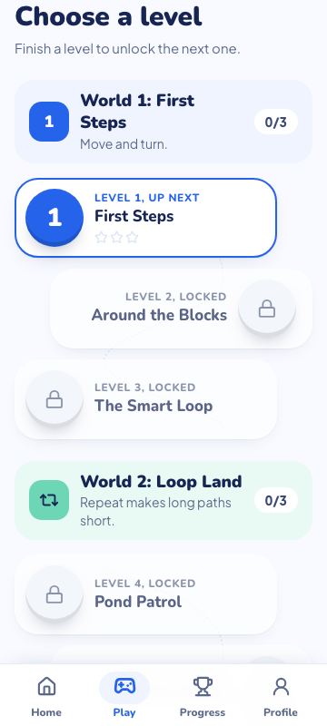

<p align="center"></p>

<p align="center"><b>Draw it. Run it. Fix it.</b><br>A playful coding adventure for kids 8–14, in <b>Bahasa Indonesia</b> and <b>English</b>, built for the Google <b>#BuildHybridAI</b> 2026 hackathon.</p>

Kids guide **Pip** the robot through mazes with visual Move / Turn / Repeat blocks, or **draw the plan on paper and photograph it**. Firebase AI Logic **hybrid inference** turns the photo into editable blocks (Gemini Nano on-device when Chrome provides it, Gemini in the cloud only with permission). A deterministic simulator runs the program, shows exactly which step went wrong, and an AI clue nudges the child without revealing the answer.

- **Live demo:** https://pencilloop-f476c.web.app (Firebase Hosting)
- **Docs:** [Architecture](docs/ARCHITECTURE.md) · [Privacy & release blockers](docs/PRIVACY.md) · [Testing](docs/TESTING.md) · [Scan accuracy](docs/scan-accuracy.md) · [Demo script](docs/DEMO_SCRIPT.md)

| Desktop 1440×900 | Phone 360×800 |
|---|---|
|  |  |
|  |  |

## Features

- **Onboarding that feels like a game:** language, nickname, birthday (no future dates), optional gender (skippable, never changes access), a note for grown-ups, then **Start the adventure!** straight into level 1. No email or password.
- **Two languages, instantly:** every screen, tip, error, badge and AI clue in Bahasa Indonesia or English. Browser language is the default; switching never reloads. Copy lives in one file per area under `src/i18n/`.
- **Mobile-first navigation:** 4 thumb-reachable tabs (Home, Play, Progress, Profile) with an animated active pill; a full sidebar on desktop (compact icon rail at 1024-1279px).
- **6 levels in 2 worlds** on an animated level map with unlock animations. Stars, points (stars + tidy bonus + first-try bonus), best score, fewest blocks.
- **9 badges** that reward learning (fix after a bump, use a clue then win, use a loop, scan a paper plan), shown as toasts and in a badge gallery.
- **Victory moments:** confetti, stars popping in with sound, score count-up, "Level 2 unlocked!".
- **Motion & sound:** shared motion tokens (Motion for React), page/tab/sheet transitions, button press depth, tooltips; original Web Audio sounds (no files) with on/off and volume. Reduced motion is respected everywhere.
- **Visual editor:** add, edit (steppers), reorder (drag, Alt+↑/↓ or buttons), delete, nest blocks in Repeat. Mobile tray with a compact timeline.
- **Deterministic interpreter:** validated AST (≤30 blocks, ≤60 moves, repeat depth ≤2) → atomic trace → outcome. Run / Pause / Step / Reset / 2× speed; the failing step is highlighted.
- **Scan your plan** and **Give me a clue** with privacy routing and honest source badges from `result.response.inferenceSource`.
- **AI prepares itself:** on supported Chrome desktops the on-device model starts downloading in the background from the first tap (`initializeDeviceModel()`); play never waits, and the cloud answers meanwhile (with permission). Technical status lives in *Profile > AI information*.
- **Anonymous-first accounts:** a Firebase anonymous account is created after onboarding; progress, badges and settings sync to Firestore per UID. **Save progress with Google** links the same UID (`linkWithPopup`), with a clear choice when that Google account already has a save. Sign-out and *Delete my data* are in Profile.
- **Child privacy:** children's nickname, birthday and gender never leave the device; nothing personal is sent to AI. See [PRIVACY.md](docs/PRIVACY.md), including the open release blockers.

## Tech stack

React 19 · TypeScript 7 · Vite 8 · Tailwind CSS 4 · Motion 14 · React Router 8 · Zod 4 · Firebase JS SDK 13 (`firebase/ai`, App Check, Auth, Firestore) · Vitest 5 · Playwright 1.65 · oxlint · Firebase Hosting.

## Quick start

```bash
npm install
npm run dev          # http://localhost:5173 — the game works without any Firebase config
```

| Script | What it does |
|---|---|
| `npm run build` | Typecheck + production build to `dist/` |
| `npm run typecheck` / `npm run lint` | TypeScript / oxlint (warnings fail) |
| `npm test` | Unit tests (Vitest, 94) |
| `npm run test:rules` | Firestore rules tests on the emulator (13) |
| `npm run test:e2e` | Playwright E2E (46): desktop, mobile, 9-viewport sweep, emulator account journeys |
| `npm run firebase:emulators` / `npm run dev:emu` | Auth + Firestore emulators and a dev server wired to them |
| `npm run deploy` | Build + `firebase deploy --only hosting,firestore` |

## Firebase setup (to enable AI)

1. Create or choose a Firebase project and add a **Web app**. Copy `.env.example` → `.env.local` and fill in the `VITE_FIREBASE_*` values.
2. **AI Logic:** Firebase console → AI Logic → *Get started* → **Gemini Developer API** (works on the free Spark plan). This also turns on App Check enforcement for AI Logic.
3. **App Check:** in Google Cloud → Security → Fraud Defense (reCAPTCHA), create a **Web** key for your hosting domains, then register it in Firebase → App Check → Apps. Put the site key in `VITE_APPCHECK_SITE_KEY`.
   For local dev, add a debug token under *Manage debug tokens* and put it in `.env.local` as `VITE_APPCHECK_DEBUG_TOKEN` (never commit it).
4. **Accounts & progress:** Authentication → enable **Anonymous** and **Google**; create a Firestore database; deploy `firestore.rules`.
5. `npx firebase login` → `npm run deploy`.

Model: the cloud fallback defaults to `gemini-3.5-flash-lite` (the documented hybrid default for SDK v13); override it with `VITE_AI_CLOUD_MODEL`.

### On-device (Gemini Nano) requirements

Chrome **Desktop 139+** with `chrome://flags/#prompt-api-for-gemini-nano-multimodal-input` enabled. The download starts automatically in the background after the first tap (it needs a user gesture, so it never starts on page load). Phone browsers are cloud-only, and only with consent. Full steps: [docs/TESTING.md](docs/TESTING.md).

## Capability matrix

| Device / condition | Cloud consent | Behaviour |
|---|---|---|
| Desktop Chrome, local ready | No | `ONLY_ON_DEVICE` — data stays on the device |
| Desktop Chrome, local ready | Yes | `PREFER_ON_DEVICE` — badge from the response |
| Local model unavailable | No | Explanation + manual editor; **nothing is sent** |
| Local model unavailable | Yes + online | Cloud fallback, `IN_CLOUD` reported |
| Phone browser | No | Full game + editor; AI waits for permission |
| Phone browser | Yes + online | Cloud AI through Firebase AI Logic |
| Offline, no local model | Any | Simulator fully playable; AI unavailable |

## What is verified vs. not

| Item | Status |
|---|---|
| 6 levels solvable, failure fixtures, step limit, invalid programs | ✅ Vitest |
| Indonesian/English dictionaries complete, no em dashes or curly quotes | ✅ Vitest |
| Onboarding, validation, language switch, gameplay, badges, delete-all, offline play | ✅ Playwright |
| No sideways scroll at 320 → 1920 px; bottom tabs on phones, rail on desktop | ✅ Playwright (9 viewports) |
| Anonymous auth, one account per player, refresh keeps UID, Firestore per-UID sync | ✅ Playwright on Emulator Suite; ✅ live site ("Saved automatically") |
| Google linking keeps the UID; conflict asks first and combines; sign-out / sign-in restore | ✅ Playwright on Emulator Suite (popup). ⚠️ Not clicked on the live site with a real Google account |
| Firestore rules: owner-only, schema, no child personal data | ✅ `npm run test:rules` (13) |
| Background on-device prep starts from the first tap, game not blocked | ✅ live site, Chrome 157 desktop: preparation started, model downloading |
| Real `IN_CLOUD` clue while the local model downloads (EN and ID) | ✅ live site, 2026-11-23 |
| Real `IN_CLOUD` image scan via Firebase AI Logic + App Check | ✅ 2026-11-23 ([results](docs/scan-accuracy.md)) |
| Real `ON_DEVICE` (Gemini Nano) response | ⚠️ implemented; the test Chrome was still downloading the model, so **not yet observed** |
| `linkWithRedirect` fallback (popup blocked) | ⚠️ implemented; did not complete in an embedded test browser (third-party storage partitioning). Popup is the primary path |

## Known limitations

- Handwriting can be misread; the review step is mandatory. Measured accuracy is on synthetic fixtures only.
- On-device web inference depends on Chrome's Prompt API availability, flags and a model download.
- "If path is clear" / branching is out of scope for the MVP.
- AI clue quality varies; replies that look like full solutions are rejected in favour of built-in tips.

## Privacy

No email or password to start, no ads, no analytics. Children's nickname, birthday and gender stay on the device; Firestore holds only an anonymous ID's age group, settings, level results and badges (adults may also keep a nickname and gender). Photos are resized in memory, sent to the cloud **only after explicit consent** (or processed on-device) and discarded after scanning. AI monitoring in Firebase is disabled. Details and open release blockers: [docs/PRIVACY.md](docs/PRIVACY.md).

## Project structure

```
src/
  i18n/           en/ and id/ dictionaries (one file per area), language detection
  app/            shell, bottom tabs + side rail, hooks
  components/     Button, Sheet, Toaster, Controls, Robot, badges, error boundary…
  features/
    maze/         missions, interpreter, validation, scoring, MazeBoard
    editor/       editor AST ops, palette, program list
    game/         game runner (animation clock), tray, status, victory
    scan/         image preparation, ScanSheet (review + consent)
    ai/           Firebase init + App Check, hybrid client, prompts, sanitizer, routing, aiStore
    hints/        trace → hint context, built-in tips, HintPanel
    audio/        Web Audio SFX engine
    account/      anonymous auth, Firestore sync, Google linking, conflict sheet
    profile/      local profile, age groups, settings panel
    progress/     local stores, scoring, achievements
  pages/          Welcome, Home, Levels, Play, Progress, Profile, AI information, Learn
e2e/              Playwright specs        tests/rules/     Firestore rules tests
fixtures/scan/    20 synthetic plans + manifest
docs/             architecture, testing, demo, accuracy, screenshots
```

## License

[Apache-2.0](LICENSE)
