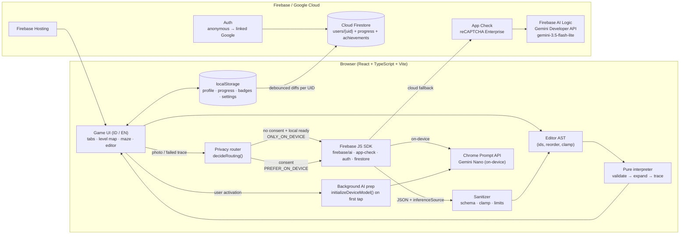

# Architecture

PencilLoop is a static React SPA on Firebase Hosting. There is **no custom backend**: the deterministic game runs entirely in the browser, and the two optional AI helpers call Firebase AI Logic directly from the client, protected by App Check.

## Data separation

| Data | Where | Notes |
|---|---|---|
| `Mission` | `src/features/maze/missions.ts` | Static, versioned; every solution verified by tests |
| `ProgramAST` | Editor state → `toCommands()` | Max 30 nodes, repeat depth 2, move 1–5, repeat 2–5 |
| `Trace` | `runProgram()` | Deterministic atomic steps, outcome, failing step; max 60 steps |
| UI state | React state in `useGameRunner` | One animation clock (`setTimeout` chain) drives playback |
| AI state | `aiStore` | `UNCONFIGURED · CHECKING · LOCAL_DOWNLOADING · LOCAL_READY · CLOUD_AVAILABLE · OFFLINE_NO_AI · SCANNING · SUCCESS_ON_DEVICE · SUCCESS_IN_CLOUD · ERROR` |
| Profile | `profileStore` (device) | Nickname, birthday, optional gender, age group. Mirrored to Firestore only for adults (see PRIVACY.md) |
| Progress, badges, settings | `localStorage` + Firestore per UID | Local is the source of truth; `account/sync.ts` pulls once per sign-in and pushes debounced diffs |
| Copy | `src/i18n/{en,id}/*.ts` | One file per area; `Dict` type forces both languages to have every key |

## AI calls

Both calls use `getGenerativeModel(ai, { mode, inCloudParams, onDeviceParams })` from `firebase/ai` with `GoogleAIBackend`:

- **Scan** — single-turn text + JPEG image → JSON (`responseJsonSchema` in the cloud, `responseConstraint` on device). Output goes through `sanitizeScan()` (unknown commands dropped, numbers clamped with warnings, nesting/size limits) and is always shown for review.
- **Clue** — single-turn text → `{hint, question}`. The prompt contains only a text grid, the child's program and the simulator result. `sanitizeHint()` rejects replies that list a solution and trims to 35 words; otherwise a labelled built-in tip is shown.

The UI badge is set **only** from `result.response.inferenceSource`. "On-device AI ready" (from `LanguageModel.availability()`) is shown separately and never presented as "used".

## Privacy routing (`src/features/ai/routing.ts`)

| Local model | Cloud consent | Online | Result |
|---|---|---|---|
| ready | no | any | `ONLY_ON_DEVICE` |
| ready | yes | any | `PREFER_ON_DEVICE` |
| not ready | no | yes | ask (Cancel / Allow once / Prepare local) — nothing sent |
| not ready | yes | yes | `PREFER_ON_DEVICE` → cloud, `IN_CLOUD` reported |
| not ready | any | no | AI unavailable; game keeps working |

## Why no Cloud Storage / Cloud Functions

- Photos are processed transiently in memory and never stored (PRD privacy requirement), so there is nothing to put in Cloud Storage.
- AI Logic is called directly from the client with App Check; no server code is needed. Both products also require the paid Blaze plan for new projects, while this project runs on the free Spark plan.

## Accounts (`src/features/account/`)

1. **Restore**: `initAccount()` waits for `auth.authStateReady()` (IndexedDB persistence), so a returning player keeps the same anonymous UID across refreshes.
2. **Create**: an anonymous account is created only when onboarding finishes (`ensurePlayerAccount()`), with backoff retries when offline.
3. **Sync**: `pullAll()` reads `users/{uid}`, `progress/*`, `achievements/*` (and migrates the v1 `progress/{uid}` doc once); `startPusher()` writes only changed documents in a batch, with server timestamps.
4. **Link**: *Save progress with Google* calls `linkWithPopup()` (fallback `linkWithRedirect()` when popups are blocked), keeping the same UID.
5. **Conflict**: `auth/credential-already-in-use` keeps the pending credential and asks the player: **combine** (best results, never lower), **switch** to the Google save (guest progress kept as a local backup), or **stay** a guest. Nothing is overwritten before the choice.
6. **Sign out / delete**: sign-out is offered only to linked players; *Delete my data* removes Firestore docs, the Auth user and local data.

## Background on-device preparation (`aiStore.ts`)

- `warmupAI()` preloads Firebase and builds the `PREFER_ON_DEVICE` model objects when the browser is idle. No AI request is made.
- `prepareOnDeviceInBackground()` is called synchronously from a click: the **Start the adventure!** button for new players, and the first click or key press for returning players (`AppShell`). It calls `model.initializeDeviceModel()` for the scan and clue models once per page load, never blocks the UI, and is skipped on phones, without the Prompt API, with Data Saver, or when turned off in *Profile > AI information*.
- While the model downloads, `PREFER_ON_DEVICE` requests (with cloud consent) are answered in the cloud; afterwards they run locally. The badge always comes from `inferenceSource`.
- Technical status (availability, preparation progress, cloud fallback, last source) lives in **Profile > AI information**, not on the game screen.
